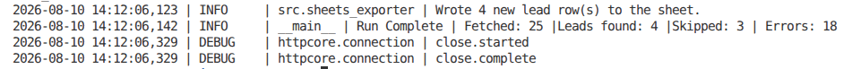
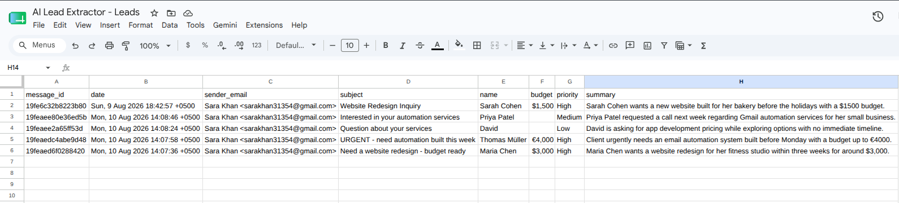
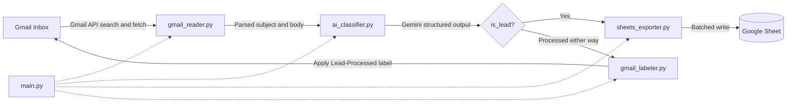

# Gmail Lead Extractor

A Python pipeline that scans a Gmail inbox, uses an LLM to decide whether each email is a genuine sales lead, extracts the key fields (name, email, budget, priority), and logs the lead to a Google Sheet. Each email is labeled once processed, so re-running the script never creates duplicates.





## Problem

Small businesses and freelancers lose leads in crowded inboxes. A client inquiry gets buried under newsletters and receipts within hours. This tool turns the inbox into a structured lead list automatically, using only free-tier services (Gmail API, Google Sheets API, Gemini API free tier).

## Design decisions

- **Schema-constrained LLM output.** Gemini is asked for output that matches a Pydantic schema, and the result is validated again in code. This avoids regex parsing of free text.
- **Idempotent runs.** A Gmail label (`Lead-Processed`) records which emails were handled, so the inbox itself is the state store. There is no separate database to keep in sync.
- **Robust email parsing.** MIME messages are walked recursively, with an HTML-to-text fallback for HTML-only emails.
- **Failure isolation.** Each email is processed inside its own error boundary, so one malformed message is logged and skipped instead of stopping the batch.
- **Batched Sheets writes** to stay within API rate limits on larger inboxes.
- **OAuth2 with token refresh** for unattended runs; no passwords are stored. Secrets live in `.env`, not in source.
- **Logging.** Every run appends timestamped entries to `pipeline.log`.

## Architecture



`main.py` orchestrates five single-purpose modules. Each can be tested on its own.

## Tech stack

| Layer | Tool |
|---|---|
| Language | Python 3.11+ |
| Auth | Google OAuth2 (`google-auth-oauthlib`) |
| Email | Gmail API |
| AI | Gemini API (`google-genai`) |
| Validation | Pydantic v2 |
| Storage | Google Sheets (`gspread`) |
| Config | `python-dotenv` |

## Getting started

### 1. Install
```bash
git clone https://github.com/SaraKhan-24/GmailLeadExtractor.git
cd GmailLeadExtractor
pip install -r requirements.txt
```

### 2. Google Cloud setup
1. Create a project in the [Google Cloud console](https://console.cloud.google.com/).
2. Enable the Gmail API and the Google Sheets API.
3. Configure the OAuth consent screen and add yourself as a test user.
4. Create an OAuth client ID (Desktop app), download it as `credentials.json`, and place it in the project root.

### 3. Gemini API key
Create a key in [Google AI Studio](https://aistudio.google.com/).

### 4. Configure
```bash
cp .env.example .env
```
```env
GOOGLE_CREDENTIALS_PATH=credentials.json
GOOGLE_TOKEN_PATH=token.json
GMAIL_SCOPES=https://www.googleapis.com/auth/gmail.readonly,https://www.googleapis.com/auth/gmail.modify,https://www.googleapis.com/auth/spreadsheets
GEMINI_API_KEY=your_key_here
GEMINI_MODEL_NAME=gemini-flash-latest
GOOGLE_SHEET_NAME=AI Lead Extractor - Leads
GMAIL_PROCESSED_LABEL=Lead-Processed
```

### 5. Run
```bash
python main.py --verbose
```
The first run opens a browser window for Google consent.

## Usage

```bash
python main.py                                              # last 30 days, up to 25 emails
python main.py --query-extra "newer_than:7d" --max-results 50
python main.py --verbose
```

## Project structure

```
GmailLeadExtractor/
├── main.py                 # Entry point and orchestration
├── requirements.txt
├── .env.example
└── src/
    ├── config.py           # Environment configuration
    ├── auth.py             # OAuth2 lifecycle
    ├── gmail_reader.py     # Fetching and MIME parsing
    ├── ai_classifier.py    # Gemini structured-output extraction
    ├── gmail_labeler.py    # Label-based deduplication
    └── sheets_exporter.py  # Batched Sheets writes
```

## Limitations

- Classification quality depends on the model and prompt; borderline emails can be misjudged.
- The Gemini free tier has rate and quota limits, so large backlogs are processed in batches.
- Google OAuth apps left in "Testing" status expire refresh tokens after 7 days, so fully unattended use needs the app published or re-authorized.
- One inbox per run.

## Roadmap

- [ ] Run summary by Slack or email
- [ ] Multiple inboxes from a config list
- [ ] Dockerfile
- [ ] Scheduled runs with GitHub Actions

## License

MIT. See [LICENSE](LICENSE).

Author: Sara Khan ([@SaraKhan-24](https://github.com/SaraKhan-24))
